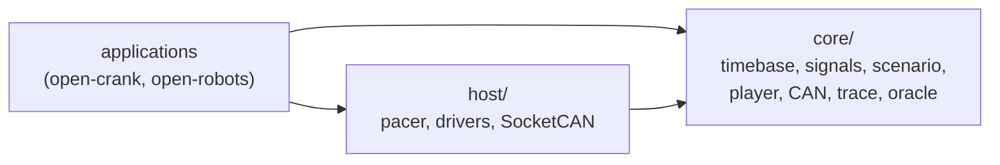

# Architecture

This document explains how open-tick v0.1 is structured and, for each decision, *why*. The reasons behind the project as a whole are in [VISION.md](VISION.md); this file covers the code that exists. The interfaces are pre-1.0 and not frozen.

## 1. What v0.1 is

v0.1 is the **extraction**: the parts of open-crank v0.1 that do not depend on a diesel engine, made into a library that open-crank can consume and that a second application could use. In practice:

- a **timebase**: simulated time as `uint64_t` nanoseconds;
- **signal tables** registered by the application, and **scenarios** parsed against them;
- a **player** that applies scenario events at the start of each step;
- **CAN and CAN FD frames**, and a bounded **queue** for the in-memory bridge;
- a **trace writer** with columns registered by the application;
- on Linux: a **pacer**, **free-run and paced drivers**, and a **SocketCAN bridge**.

Nothing in v0.1 is signal-level (no Pico, no FPGA), and there is no fidelity contract yet: those are v0.4 (the Tang Nano 20K bridge) and later.

## 2. Zones and the dependency rule



| Zone | Contains | May depend on | Must not contain |
|---|---|---|---|
| `core/` | timebase, signals, scenario, player, CAN frames and queue, trace, oracle | the ISO C11 standard library | OS headers or feature macros (`_POSIX_C_SOURCE`, ...), clocks, sockets, anything from `host/` |
| `host/` | pacer, drivers, SocketCAN bridge | `core/`, the operating system | physics, the meaning of any message |

**The rule: dependencies point one way, and open-tick never includes an application.**

**Why.** open-crank learned that without an enforced rule, code drifts: its first "reference firmware" was a Linux process. Here the danger is the other way round. A core that picks up an open-crank header is no longer a core, and one that picks up POSIX calls no longer builds on every host.

**Enforcement (CI, not promises): [`tools/check_deps.sh`](tools/check_deps.sh).**

1. Every `#include` in `core/` is an ISO C header or one of core's own headers, and no file in `core/` asks for OS extensions.
2. Every include with a path in the whole tree is either `opentick/...` and exists, or lives in a known system directory (`sys/`, `linux/`, `net/`, `netinet/`, `arpa/`). `<opencrank/j1939.h>` fails.
3. A CI job builds and tests `core/` on macOS, where the Linux-only host zone is left out. "Builds anywhere" is checked, not claimed.

## 3. Modules

### 3.1 Timebase (`core/include/opentick/timebase.h`)

`OtkNs` is a `uint64_t` count of nanoseconds, with conversion helpers.

**Why nanoseconds.** This settles VISION.md's open question 2. Message transports would be content with milliseconds, but signal-level bridges timestamp edges in tens of nanoseconds (an RP2040 at 125 MHz ticks every 8 ns). Choosing the unit now means the scenario format and the player do not change when the bridges arrive.

**Why 64 bits.** 2^64 ns is about 584 years. Time never wraps, so comparisons stay plain `<=` with no wrap-safe arithmetic.

**Why applications may keep their own unit.** open-crank's engine ECU, bench and controller count `uint32_t` milliseconds, and the controller's counter is part of firmware that must stay small. They convert at the boundary (`otk_ns_from_ms`). Forcing nanoseconds into firmware would gain nothing.

### 3.2 Signals (`signals.h`)

The application registers a table of names, and **a signal's id is its index in that table**. An application can therefore keep an enum that matches its table, as open-crank does with `OcSignalId`.

- Names use letters, digits, `_`, `.` and `-`; they must be unique and must not be `end`.
- `end` is reserved by open-tick, with the id `OTK_SIGNAL_END`.

**Why a table and not callbacks per name.** A table is data. It can be checked once (`otk_signal_table_check`), listed in error messages, and later generated from a YAML profile (v0.5).

**Why the table is checked on every parse.** A duplicate name would make one signal unreachable without any error. The check is a few string comparisons, so it costs nothing next to reading a file.

### 3.3 Scenarios (`scenario.h`)

These use the CSV format of open-crank v0.1, unchanged: `time_s,signal,value`, comments and blank lines ignored, and loud errors with line numbers. Two things differ: names come from the application's table, and times are rounded to the nearest nanosecond. A scenario holds up to 1024 events in a fixed array; there is no `malloc`.

**Millisecond times stay exact.** A test parses every time from 0.000 s to 30.000 s and checks that each maps to exactly `ms × 10^6` ns. Without that guarantee, an event could move into a different step after the extraction.

**Why `end` is stored as an event.** It keeps `n` meaning the same as in open-crank (every line, `end` included), and the order checks ("event after `end`") stay in one place.

### 3.4 Player (`player.h`)

`otk_player_advance(p, now)` applies every event with `t <= now` that has not been applied yet, in file order. It never hands `end` to the application. `otk_player_done(p, now)` is true once `now` reaches `end`.

**Why the machine passes `now` in.** The player never reads a clock. That is what lets the same scenario drive a free-running CI test, a paced SIL run and, later, an emulator in lockstep.

**Why "at the start of the next step".** An event at 15 ms with 10 ms steps applies at 20 ms. This is open-crank's behaviour; changing it would move every fault in every scenario.

### 3.5 CAN (`can.h`)

`OtkCanFrame` holds an 11- or 29-bit identifier, flags (`EXTENDED`, `FD`, `BRS`), a length and up to 64 bytes. `otk_can_frame_valid` checks identifier range, length and flags. `OtkCanQueue` is a bounded FIFO whose capacity is set at runtime, up to 64 frames. A push into a full queue fails and is counted.

**Why CAN FD from the start.** The STM32G4 family that open-crank targets has FDCAN, and adding 56 bytes to the frame later would break every application's API. The cost is 72 bytes per frame instead of 16.

**Why the queue's capacity is a runtime setting.** open-crank's in-memory loop held 32 frames. With a fixed, larger capacity, an overflow that open-crank's tests would see could no longer happen, which is a change in behaviour. Each application keeps its own number.

**Why frames are not interpreted.** A frame is an identifier and bytes. J1939 belongs to open-crank, so open-crank converts between `J1939Frame` (in `portable/`, which goes to firmware and must never see open-tick) and `OtkCanFrame` on the host side.

### 3.6 Trace (`trace.h`)

The application declares its columns once (name, kind, decimals) and then writes each row value by value. Values are formatted with the same printf formats open-crank used (`%.*f`, `%lld`, `%llu`, `%s`), so a trace written through the writer is byte-for-byte the hand-written one.

**Why errors are sticky and rows stay whole.** A trace whose columns silently shift plots the wrong signal under the right heading, which is worse than a crash. These all set an error, and the first one is kept:

- a value of the wrong kind;
- a missing or extra value;
- text containing a comma, quote or line break.

The writer still keeps every row on one line with the right number of fields, so the file stays readable while the error is reported.

**Why the caller owns the `FILE *`.** The writer never opens or closes files, so an application can trace to a file, `stdout`, or a pipe.

### 3.7 Pacer and drivers (`host/`)

The **pacer** sleeps until absolute `CLOCK_MONOTONIC` deadlines. It is open-crank's pacer, with two changes:

- the period is in nanoseconds;
- it **measures how late each wake-up was** (`last_late`, `max_late`), alongside the overrun count.

A late iteration restarts the schedule from now instead of running a burst of catch-up steps.

A **driver** wraps one loop shape for every mode: step, then `otk_driver_wait`. Free-run returns at once; paced calls the pacer. The virtual (emulator) and hard (bridge) drivers will be more cases of the same enum.

**Why measure lateness now.** The fidelity contract (VISION.md §5.4) needs measured timing, not assumed timing. A paced SIL run can already report its worst wake-up, as `otk-flywheel --driver paced` does.

**Why Linux only.** `clock_nanosleep` and SocketCAN are Linux APIs. macOS has neither, and porting the pacer is a contribution waiting for a user.

### 3.8 SocketCAN bridge (`host/socketcan.h`)

This is a non-blocking raw socket for classic CAN and CAN FD. Its behaviour:

- **11-bit and 29-bit frames are both delivered**, with `OTK_CAN_EXTENDED` telling them apart.
- **RTR and error frames are skipped.**
- **Bytes past the length are zero.**
- **CAN FD is used only if the interface's MTU allows it.** Sending an FD frame on a classic interface fails with `EMSGSIZE` instead of being truncated.

**Why deliver 11-bit frames.** open-crank's glue dropped them because J1939 uses 29-bit identifiers only. That filter belongs to J1939, so it moved to open-crank's conversion function (`oc_frame_from_otk`). CANopen, for example, needs 11-bit frames.

**Timestamps** *(v0.3.1)*. `otk_socketcan_enable_timestamps()` turns on the kernel's receive timestamps (`SO_TIMESTAMPNS`) and, optionally, the socket's own sent frames back (`CAN_RAW_RECV_OWN_MSGS`, flagged `MSG_CONFIRM`), stamped when they left on the interface. `otk_socketcan_recv_ex()` returns them; `otk_socketcan_recv()` skips the socket's own frames, so code that does not ask sees what it saw before. **Why the own-frame copy for sent frames:** it gives a sent frame a kernel time on the same clock as a received one, so a frame log names one clock for the whole file.

### 3.9 Oracle (`oracle.h`)

The acceptance oracle grades a run from the frames a device under test (DUT) sends, against criteria written as data. It moved here in v0.2.0 from open-crank v0.2.1 (`sim/oracle/`), where it was proven on seven scenarios over `vcan` and on a board. The criteria format is a contract: [docs/criteria-format.md](docs/criteria-format.md).

**Why it is generic.** The oracle knows no protocol. The application gives it a table of observables (name, stale time, default) and a function that decodes a frame into new values for them. open-crank decodes J1939 and keeps only the DUT's frames in its own decoder; `otk-flywheel` decodes one 11-bit frame. Nothing from J1939 or any application enters `core/`: `tools/check_deps.sh` rejects any application header.

**Why criteria are data.** A criteria file is text next to its scenario, not code. The same file grades a run in memory, on `vcan` and with a board on the bus, and a criterion can be read and reviewed by someone who does not read C.

**Why the API is in `OtkNs` and the file in milliseconds.** The API takes time as `OtkNs`, like the rest of `core/`, so an application hands it the same timestamps it uses everywhere else, and an event that does not fall on a whole millisecond is measured from its exact time. The file stays in milliseconds because people write it, a millisecond is fine enough for a bus, and keeping the unit means no existing criteria file changes.

**Why memory is fixed.** There is no `malloc`: criteria, terms and grading state live in fixed arrays inside `OtkOracle`, with the limits in `oracle.h`. An `OtkOracle` is large (tens of KiB), so applications keep it off the stack, as `otk-flywheel` does with a static.

**Why the step at `end` is graded.** A window that ends at `end` is covered only if the step at `end` is evaluated. `otk-flywheel` learned this when its criteria were added: its loop stops before the last step, and without one more evaluation at `end`, with the frames the DUT sent in the last step, no window up to `end` was covered. open-crank's runners already evaluated that step.

**Why verdicts are a file of their own** (v0.2.1). `otk_oracle_write_verdicts()` writes one CSV row per criterion: verdict, status, window, event, reaction and first violation, in seconds on the trace's time axis ([docs/verdict-format.md](docs/verdict-format.md)). A viewer can then draw where each window started, where the reaction ended and where a criterion failed, which the text report only says in words. It is a separate file because the trace stays as it is: a trace has no rows for criteria, and adding columns to it would change every existing trace. The writer and `otk_oracle_report()` read the same state through the same functions (`status_of`, `reaction_of`, `reaction_ns`, `print_ms`), so the file and the report cannot disagree. `test_oracle` checks them row by row.

**What it does not do.** It sees only frames, never the DUT's internal state. It grades the reaction, not its reason: a controller that stops driving because it lost its speed feedback and one that stops for any other reason look the same on the bus.

### 3.10 Links and transport faults (`link.h`) *(v0.3)*

A link is one direction of a CAN path. The sender pushes each frame with the time it was sent, and the receiver pops the frames whose delivery time has come. On the way, the link can drop frames, drop one in N, delay them, add jitter, corrupt one byte, or go bus-off. A scenario drives each fault through six signals per link, `fault.link.<name>.*`. What each fault simulates, and what not, is in [docs/link-faults.md](docs/link-faults.md).

**Why in `core/`.** Transport faults are the same for every application: a lost frame is lost whether it carries J1939 or a toy protocol. A link only moves `OtkCanFrame`s and never reads them. It works wherever frames pass through the application's process, in memory or between a SocketCAN socket and a bench. Domain faults, such as an engine ECU that ignores TSC1, stay in the application.

**Why one fault per filter and values from the scenario.** Which frames a fault applies to is a property of the application's message set, so the application sets the filters in code. When a fault happens, and how strong it is, belongs to the test, so the scenario sets the values. Because they are ordinary signals, the oracle times reactions from them with no new syntax.

**Why a frame never overtakes an earlier frame with the same identifier.** That is what a real bus does with one sender's frames. The rule also settles what happens when the delay drops while frames are in flight.

**Why the jitter has its own seeded PRNG.** Free-run must stay byte-identical run to run. A PRNG inside the link, splitmix64 seeded by the application, gives the same draws on every host, and it does not depend on any other random numbers the application uses.

**Why memory is fixed.** The delay line holds `OTK_CAN_QUEUE_MAX` frames in an array inside `OtkLink`, as the queues do. A full line counts an overflow instead of growing.

**What it does not do.** It does not simulate a real bus-off, error frames, arbitration or bus load. A link is not a bus model.

**What happened to each frame** *(v0.3.1)*. `otk_link_push_ex()` and `otk_link_pop_ex()` report why a frame was lost (drop, drop one in N, bus-off, overflow), whether it was corrupted, and when it was pushed. `pop_ex` also returns the frames that bus-off loses when they fall due, which `otk_link_pop()` drops without a word. `otk_link_push()` and `otk_link_pop()` are these with the report thrown away, so their behaviour is unchanged (`test_link` is untouched, and open-crank's bench uses them).

### 3.11 Frame logs (`framelog.h`) *(v0.3.1)*

A frame log is every CAN frame of a run, one row each, with two times: `t_s`, the step in which it crossed the machine's side, and `t_bus_s`, when it was on the device under test's side, measured by a clock that the file names. The contract is [docs/frame-log-format.md](docs/frame-log-format.md).

**Why the application writes it, not the links.** Links are queues that the application places where its faults belong, and not every frame passes through one: open-crank's links sit inside its simulated bench, and its operator panel's frames bypass them. Only the application knows its bus boundary, which way a frame goes and which link carried it. open-tick gives the writer and the links' reports.

**Why two times, and why `t_s` governs.** The step time is deterministic and is the axis of the trace and the verdicts, so a frame placed by it lines up with both exactly. The bus time is a measurement that depends on the clock: exact in memory, the kernel's on SocketCAN, a bridge's oscillator in v0.4's hard mode, where the host's clock can only be mapped onto the bridge's with an error that the file must state (`bus_clock_err_ns`).

**Why times are printed from integers.** Nine decimals from a `double` would round; the writer prints seconds and nanoseconds from the integer, so `t_bus_s − t_s` of a 300 ms delay reads as exactly 0.300000000.

**Why rows are in the order fates become known.** A delayed frame's bus time is known only when it is delivered. Keeping time order would need the writer to hold rows back; a reader sorts by `t_s` instead.

### 3.12 Bridge protocol codec (`bridge.h`) *(v0.4, in progress)*

The host ↔ bridge protocol, version 1 ([docs/bridge-protocol.md](docs/bridge-protocol.md)), as pure functions in `core/`. It covers:
- framing with CRC-16/IBM-3740;
- the payload of every message, encoded and decoded;
- a stream parser that resynchronises on the sync byte;
- the conversions from speed to phase increment and from a fraction to an analog value;
- the extension of a capture's 32-bit tick to 64 bits.

The gateware and the hard driver that will use it are *(planned)*.

**Why both sides in one codec.** The host encodes requests and decodes replies. A bridge simulator, the tests and the vectors for the gateware's testbenches need the other direction, so one codec avoids two descriptions of the same bytes drifting apart.

**Why in `core/`.** It is ISO C with no I/O, clock or allocation, so the same code builds on Linux, macOS and, later, on a bridge with a CPU (the Raspberry Pi Pico).

**Why a failed candidate frame is dropped one byte at a time.** A frame cut short, for example by the BL616's banner after programming (F-18), can swallow the start of the next frame. Dropping only its sync byte lets the parser find a valid frame that starts inside it.

## 4. Consuming open-tick

open-tick builds as a subproject, through `add_subdirectory` (a submodule or a sibling checkout) or `FetchContent`. As a subproject it builds only its libraries. Tests and examples are off unless the parent turns them on (`OTK_BUILD_TESTS`, `OTK_BUILD_EXAMPLES`).

```cmake
add_subdirectory(path/to/open-tick ${CMAKE_BINARY_DIR}/open-tick)
target_link_libraries(my_sim PUBLIC opentick::core)
target_link_libraries(my_sil PRIVATE opentick::host)   # Linux
```

Compile settings (C11, no extensions, warnings) are set on open-tick's own targets only, so a parent project's flags are left alone.

open-crank consumes it as a git submodule in `external/open-tick`; what that changed in open-crank, and how it was verified, is in [docs/open-crank-integration.md](docs/open-crank-integration.md).

## 5. Tests

- **Unit tests** use `CHECK` (never `assert`), so Release builds still test.
- **`test_scenario` keeps open-crank's parser cases**, adapted to tables and nanoseconds, so the extracted parser accepts and rejects what the original did.
- **Wall-clock tests check only bounds that hold on a loaded machine.** A paced loop can never finish early; there is no upper bound to make them flaky.
- **`test_socketcan` needs a CAN interface** and reports itself skipped, not passed, without one. CI sets up `vcan0` with a CAN FD MTU when the runner allows it, and warns when it cannot.
- **`otk-flywheel` runs as a test.** Two free-running runs must produce identical traces (determinism), and a paced run must complete. With `delay.csv`, the oracle must pass the controller (`example_flywheel_delay_accept`), and two runs must give identical traces.
- **`test_link`** covers each fault, its filter, delivery order, overflow, the scenario signals, the determinism of the PRNG for a given seed, and what `push_ex` / `pop_ex` report.
- **`test_framelog`** checks the exact text, every refused row, a write → read round trip of a link in memory (delay exact, each loss, corruption, order) and determinism. `example_flywheel_frames` compares `otk-flywheel --frames` with [examples/flywheel/delay.frames.csv](examples/flywheel/delay.frames.csv) byte for byte. `test_socketcan` checks kernel timestamps and own frames on `vcan`.
- **`test_bridge`** checks the bridge codec against the specification:
  - the CRC's check value;
  - a request byte for byte;
  - every message both ways, and the budget (446 B for the largest request, 125 B for a reply with 8 captures);
  - the parser on a banner, a truncated frame, a corrupted frame, sync bytes inside a payload, and one byte at a time;
  - the units at their limits.
- **[`tools/mutation_check.sh`](tools/mutation_check.sh)** breaks 53 behaviours that applications rely on (45 without a CAN interface), and the tests must catch each one. Six are the bridge codec's. Eight are the links' faults (one per fault, plus the order rule and the filter), four the links' reports, six the frame log writer's and one `otk-flywheel`'s.
