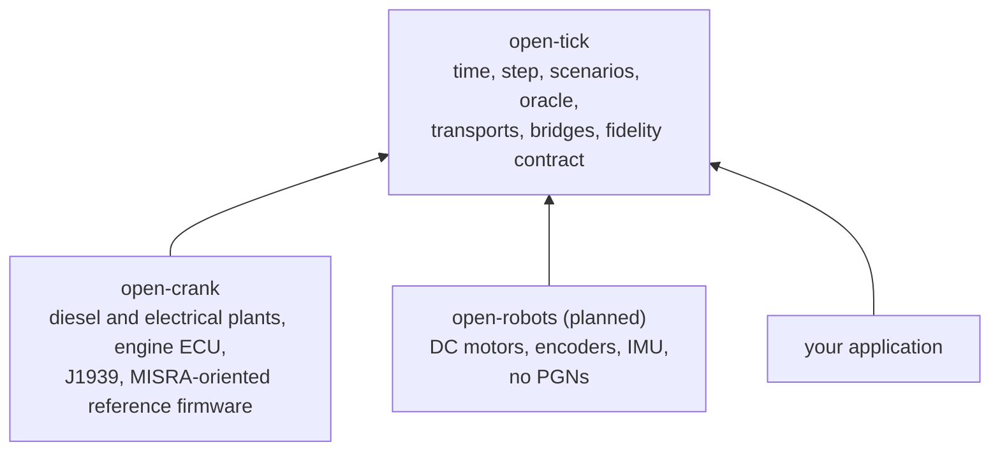

# open-tick: vision

> **Status: v0.1 (extraction) and v0.2 (oracle) done; v0.3 (transport faults) next, pulled by open-crank v0.3.** This document records the decisions taken so far and the reasons for them, so that the code has something to be checked against. The code that exists is described in [ARCHITECTURE.md](ARCHITECTURE.md). Nothing here is a feature until [ROADMAP.md](ROADMAP.md) says it is done.

## 1. The idea in one paragraph

To a microcontroller, the world is voltages on pins, edges with timing, and frames on a bus. It cannot see the crane, the robot or the train behind them. If something produces those signals faithfully enough, the firmware cannot tell a simulated machine from a real one. open-tick is the part of that "something" that does not depend on the machine. It keeps simulated time, steps the plants, plays scenarios, grades the device under test by what it can observe, and carries signals between the simulation and a real microcontroller, over a bus or on its pins. It also states exactly how faithful that is. Applications such as [open-crank](https://github.com/Open-Heavy-Machinery/open-crank) and open-robots bring the machines.

## 2. Why it exists

open-crank started because a Liebherr D936 and a Mitsui MAN B&W 9S50ME do not fit in an 8 m² apartment in Tokyo, and the STM32G431KB that was meant to control them needed something on the other side of its pins. Building that something meant writing a lot that has nothing to do with diesel engines: a step contract that never reads a clock, drivers that decide how fast simulated time passes, scenarios as data, fault injection, a trace, and tests that grade a controller by its frames. None of that cares whether the machine is a crane, a RoboCup Junior Soccer Open robot with four Pololu motors, a humanoid or a set of train doors. The microcontroller does not care either.

What someone who wants to develop embedded control against a machine they do not have can use today:

| Option | What it gives | What is missing |
|---|---|---|
| Unit tests, logic-only SIL | fast, cheap checks of logic | nothing answers back; no physics, no timing |
| Commercial HIL systems | exactly this problem, solved, with FPGA I/O | priced for companies, closed |
| FMI / FMU | an open standard for packaging plant models | says nothing about how a real microcontroller connects to one |
| Robotics simulators (Gazebo, Webots, MuJoCo, ...) | rich physics | assume the controller is software on the host, not interrupts on an STM32 |
| MCU emulators (Renode, Wokwi, QEMU, ...) | the chip, emulated | little or no plant behind the pins |

As far as we know, nothing open and affordable combines **a plant contract, one timebase, scenarios with pass/fail criteria and a bridge costing a few dollars to a real microcontroller's pins.** That combination is the reason open-tick exists.

## 3. The family



| Project | Brings | Transports it uses | First signal-level bridge |
|---|---|---|---|
| **open-tick** | time, step, scenarios, oracle, transports, bridges, fidelity contract | all of them | (it owns the bridges) |
| **open-crank** | diesel and (later) electrical plants, simulated engine ECU, J1939 PGNs, reference firmware, machine profiles | CAN (its Level 1); tooth wheels, injector capture, analog (its Level 2) | Tang Nano 20K |
| **open-robots** *(planned)* | generic DC motors, encoders, IMU, no J1939 | UART for SIL; quadrature out, PWM capture | Raspberry Pi Pico (PIO) |

**The rule: applications depend on open-tick, never the other way round.** This is the same one-way rule that open-crank enforces between its zones, and it will be enforced the same way: by a CI check, not a promise.

**What stays in an application:** physics, the meaning of its protocols (J1939 PGNs belong to open-crank), domain logic such as a simulated engine ECU, reference controllers and machine profiles.

**What moves to open-tick:** everything a second machine would otherwise have to write again.

## 4. Vocabulary

| Term | Meaning |
|---|---|
| **DUT** | device under test: the microcontroller and firmware being developed. It is never part of open-tick. |
| **plant** | physics only: `step(state, params, inputs, dt)`. No clock, no I/O, no decisions. |
| **machine** | plants, loads and domain logic assembled into what the DUT sees (open-crank calls this the bench). |
| **application** | a project that provides machines: open-crank, open-robots. |
| **signal** | one named quantity crossing between the machine and the DUT, owned by exactly one side. |
| **transport** | how a signal crosses: a message transport (CAN, UART) or a signal-level transport (edges, levels, registers). |
| **bridge** | what carries transports between the simulation and the DUT: in-memory, host, Pico, Tang Nano 20K, Renode. |
| **driver** | what decides how fast simulated time passes: free-run, paced, virtual, hard. |
| **scenario** | time-ordered signal changes and faults, as data. |
| **oracle** | the grader: pass/fail from what is observable on the DUT's transports only. |
| **profile** | parameters and wiring of a machine, written in YAML and compiled to C. |
| **fidelity contract** | what a machine needs from a bridge, against what the bridge guarantees. |

## 5. Decisions

### 5.1 One clock, one source of truth

- **Simulated time is an integer count owned by the core.** No plant or machine ever reads a clock. In open-crank this is what made free-running CI, wall-clock SIL and (planned) lockstep emulation the same code, and it carries over unchanged.
- **A driver decides how fast that time passes:**

  | Driver | Who sets the pace | Deterministic | Used for |
  |---|---|---|---|
  | free-run | the CPU, as fast as it can | bit for bit | tests, CI |
  | paced | the host's wall clock (soft real time) | no | interactive SIL |
  | virtual | an emulator, in lockstep | bit for bit | firmware in the loop in CI (Renode) |
  | hard | the bridge's oscillator | no: measured instead | real silicon on the pins |

- **In hard mode, the bridge is the clock.** It tells the core when to step and timestamps everything the DUT does on the same timebase. Exactly one clock is authoritative in any run.
- **Every signal has exactly one owner, simulated or real.** This rule comes from open-crank's roadmap; open-tick enforces it when a machine is wired.
- **Determinism is promised only where it can be kept.** With real silicon in the loop, runs are not bit-identical, so the hard driver measures jitter and latency and writes them into the trace instead.
- **A change from open-crank:** open-crank counts time in `uint32_t` milliseconds, which is enough for message transports. Signal-level transports timestamp edges in microseconds or finer, so the core's timebase is `uint64_t` nanoseconds (decided in v0.1; see [ARCHITECTURE.md](ARCHITECTURE.md), §3.1). Applications keep their own step periods and units.

### 5.2 Two kinds of transport

**Message transports.** These are CAN / CAN FD and UART first, with others when an application needs them. The DUT sends when it wants to and the machine answers in its next step, with tolerances in milliseconds. The host can carry them (SocketCAN, a serial port) as well as a bridge can, so they work in pure SIL with nothing but a USB adapter.

**Signal-level transports.** These are edges, levels and registers. The DUT expects an answer within an edge or a bit time, which a host behind USB cannot meet. They live in the bridge, and the core feeds them once per step:

- **Rotary patterns: angle and speed in, edges out.** Quadrature encoders, hall sensors, N−M tooth wheels (60−2 crank), cam wheels. **This is one primitive, not four.** A robot's wheel encoder and a diesel's crank wheel differ only in the pattern table. The bridge integrates speed between steps with a numerically controlled oscillator, so edges stay phase-continuous at any speed even though the plant only steps every millisecond.
- **Pulse capture.** PWM duty and frequency, direction pins, injector pulses with start and width timestamps. The bridge measures them over each step and reports the results.
- **Register-mapped slaves.** I²C and SPI devices such as an IMU. On these buses the DUT is the master and expects the slave to answer inside the transaction, between clock edges. The bridge holds the device's register map and answers by itself; the core only updates register values each step.
- **Levels.** GPIO in and out (limit switches, door interlocks, relays) and analog out (PWM with an RC filter, or a DAC).

**Why the split.** A transport that must answer within a clock edge cannot cross USB. Deciding up front which transports live on the host and which in the bridge keeps the bridges simple and the host protocol small.

**Transports carry signals; they do not interpret them.** The meaning of a frame belongs to the application. Transports are not tied to domains either: if someone wants to command a crane over UART, open-tick will carry the bytes. Who are we to judge?

### 5.3 Bridges

| Bridge | Link to the core | Transports | Status |
|---|---|---|---|
| in-memory | same process | message | v0.1 (CAN queues; open-crank's loop uses them) |
| host | SocketCAN, serial port | message | SocketCAN v0.1 (classic and CAN FD); serial planned, when an application needs it |
| **Raspberry Pi Pico (RP2040 / RP2350, PIO)** | USB | signal-level | when open-robots starts |
| **Tang Nano 20K (Gowin GW2AR-18)** | USB | signal-level | planned: open-tick v0.4, for open-crank v0.4 (first signal-level bridge) |
| Renode | lockstep, virtual time | message (later signal-level) | Track R (moved here from open-crank) |

- **Pico for open-robots.** It costs about 5 USD, and its PIO state machines produce and capture edges with clock-cycle resolution. A four-motor robot needs about four quadrature outputs and four PWM-plus-direction captures. The RP2040 has 8 state machines and the RP2350 has 12; the first spike confirms whether the whole robot fits in one Pico.
- **Tang Nano 20K for open-crank.** The edge rates are not the hard part: a 60−2 wheel at 2,200 rpm gives about 2.2 kHz of teeth. The hard part is the number of independent timed channels open-crank's Level 2 needs at once: crank, cam, one capture per injector, analog outputs, and room for a second engine. Many parallel channels, each with its own timing, is what an FPGA is for.
- **Both signal-level bridges speak the same host protocol.** An application chooses a bridge in configuration, not in code.
- **Electrical scope: 3.3 V logic only.** 5 V boards (Arduino Uno class) need level shifting, and that is declared in the fidelity contract. Bridges never drive motors, actuators or anything that carries power.

### 5.4 The fidelity contract

"The microcontroller cannot tell the difference" is true only within limits. open-tick makes those limits explicit, so that a passing run means something.

- **A machine declares, for each signal:** direction, transport kind, maximum edge or frame rate, timing resolution, latency budget and logic level.
- **A bridge declares what it guarantees:** channels of each kind, resolution, measured latency and jitter, and logic levels.
- **Before a run, open-tick checks one against the other.** It refuses a run that cannot be faithful and names the signal and the number that fails. Running anyway is possible, but the report then marks the run as degraded.
- **During hard runs, the measured jitter and latency go into the trace,** so the claim is checked rather than assumed.

Illustrative only; the format is not designed yet:

```yaml
# open-robots: one wheel
signals:
  - name: wheel_fl.encoder
    kind: quadrature_out
    max_edge_rate_hz: 12000   # 64 counts/rev x 50:1 gearbox at ~220 rpm output: ~11.7 k counts/s
    resolution_us: 1
    level: 3v3
  - name: wheel_fl.pwm
    kind: pwm_capture
    max_frequency_hz: 20000
    latency_budget_us: 1000   # the plant sees a duty change within one 1 ms step
    level: 3v3
```

**Why.** open-crank's definition of done says no claim may be stronger than the code and tests support. Without a fidelity contract, a DUT can pass against a degraded reality (a serial link too slow for its loop, a bridge with too few channels) and nobody would know. As far as we know, no open tool states this. It is what turns "the microcontroller cannot tell" from a slogan into a checked statement.

### 5.5 Profiles: parameters and wiring, never equations

- A **profile** says which plants and loads a machine has, their parameters with provenance, which signals it exposes on which transport, and its fidelity requirements.
- Profiles are **YAML compiled to C at build time** by a tool in open-tick. Each application defines its schema and owns its profiles. For example, open-crank's cranes and generator sets, shared by people who know those machines.
- **Physics stays in code:** C in the applications or, later, an imported FMU.

**Why compile.** The runtime stays deterministic and needs no parser, and a profile works where there is no file system.

**Why no equations.** A YAML that describes equations is a modelling language, and Modelica and FMI already exist. A profile should be a file anyone can review, not a program in disguise.

### 5.6 Scenarios, faults and the oracle

- **Scenarios stay as open-crank has them:** CSV, time-ordered, failing loudly on a typo. Signal names come from the application. Today they are a fixed enum in open-crank; in open-tick they become a table the application registers.
- **Transport-level faults come from open-tick, for every application:** lost, corrupted or delayed frames, bus-off, jitter, a stuck pin, a missing tooth, a dead encoder channel. Domain faults (an engine ECU that ignores TSC1) stay in the application.
- **The oracle grades the DUT only by what it can observe on its transports,** with reaction times measured from the injected event. This generalises open-crank's acceptance suite (its v0.2.1, released 2026-11-23). It works for any DUT, in any language, on any board.
- **Tests must be able to fail.** Each application keeps its own mutation checks; open-tick provides the pattern.

## 6. What moves out of open-crank, and what has to change

The current code (open-crank v0.1) already separates most of this. The table says what each piece becomes and what stands in the way. The extraction is done in open-tick v0.1; the trial run against open-crank is recorded in [docs/open-crank-integration.md](docs/open-crank-integration.md).

| open-crank today | In open-tick | Change needed |
|---|---|---|
| bench owns `t_ms` (`uint32_t` ms), `sim/runtime/bench.h` | core timebase | widen for signal-level timestamps |
| wall-clock pacer, `platforms/linux-socketcan/pacer.c` | paced driver | none expected |
| in-memory loop, `sim/runtime/loop.c` | free-run driver and in-memory bridge | queues of `J1939Frame` become a generic CAN frame; the J1939 meaning stays in open-crank |
| scenario parser, `sim/runtime/scenario.c` | scenario parser | signal names: fixed `OcSignalId` enum → table registered by the application |
| CSV trace, `sim/runtime/trace.c` | trace writer | columns: hard-coded → registered by the application (bridge timing columns come with the hard driver, v0.4) |
| SocketCAN glue, `platforms/linux-socketcan/socketcan.c` | host bridge, CAN | none expected |

**What stays in open-crank:** the plant core, loads, simulated engine ECU, J1939 codec, reference machine controller, the `d936la6` plant, the scenario files and the bench itself (as open-crank's machine).

**Safety net for the move:** open-crank's closed-loop tests and its 18 mutation checks, plus **bit-identical traces for every scenario before and after**. If a trace changes by one bit, the extraction changed behaviour and is wrong.

## 7. Non-goals

Honest non-goals. Revisit them; do not quietly break them.

- **Not a physics engine or a modelling language.** Physics lives in applications, or in FMUs and external simulators that open-tick bridges to.
- **Not on the DUT.** open-tick never runs on the device under test. The firmware on the Pico and the gateware on the Tang Nano are part of the bridge, not of the DUT.
- **Not a protocol stack for the DUT.** Like open-crank, which is not a J1939 stack, open-tick carries frames; the DUT brings its own stack.
- **Not power HIL.** Logic-level signals only. Never connect a bridge to real actuators, motors or machinery.
- **Not a certified tool.** No ISO 26262, IEC 61508 or EN 50128 argument. It is for practice, development and regression, not sign-off.
- **Not an MCU emulator.** Renode and others do that; open-tick drives them in lockstep.
- **Not a general robotics simulator.** Gazebo, MuJoCo and others exist; bridging to them is possible later.
- **Not every machine at once.** Nothing is generalised until a second application needs it.
- **Not ahead of its applications.** open-tick builds only what an application's current milestone needs (the pull rule in [ROADMAP.md](ROADMAP.md)).

## 8. Open questions

1. **Host-to-bridge link and protocol.** USB CDC on the Pico; on the Tang Nano 20K, its on-board USB-UART or an external USB chip. Measure throughput and latency first, before anything depends on them, as open-crank v0.2 does with its USB-CAN adapter.
2. **Timebase width.** *Decided in v0.1:* `uint64_t` nanoseconds in the core, with the bridge's clock mapped onto it ([ARCHITECTURE.md](ARCHITECTURE.md), §3.1).
3. **Tang Nano 20K toolchain.** Is the open toolchain (Yosys, nextpnr, Apicula) mature enough for the GW2AR-18, or does the gateware need Gowin's IDE? This decides whether the project can promise an all-open build.
4. **Where device models live.** IMU register maps and motor-driver behaviour: in open-tick as a shared library, or in each application?
5. **Repository and build mechanics.** How applications consume open-tick (CMake `FetchContent`, a submodule, an installed package), and how CI checks the one-way dependency across repositories. v0.1 builds as a subproject either way; the choice for open-crank is laid out in [docs/open-crank-integration.md](docs/open-crank-integration.md).
6. **Language bindings.** C11 core as in open-crank; Python bindings for scripting scenarios stay in the backlog until someone needs them.
